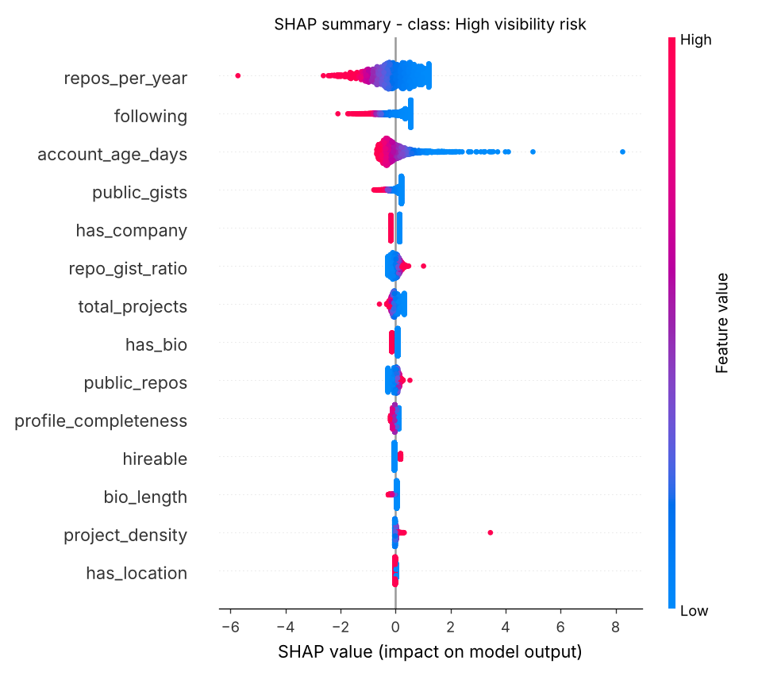

# 👨‍💻 GitHub Developer Visibility Risk Prediction
### Behavioral analytics on 21,000 real GitHub developer profiles: leak-free, explainable, deployable

Predicts whether a GitHub profile is at risk of **low visibility** (few followers), using only signals the developer controls: publishing cadence, gists, networking, account history and profile completeness. It then explains **which signals raise or lower the risk** and what to change.

```text
$ python src/predict.py --username <github-user>

GitHub visibility risk for @example-fresher: HIGH
  probabilities  High 88% | Medium 11% | Low 0%
Pushing risk UP:
  - Public repos created per year: 1.702
  - Public gists: 0
  - Developers you follow: 2
What to change:
  1. Ship small public projects more regularly; one solid repo a month beats a burst of forks.
  2. Share useful snippets as gists (SQL queries, configs, scripts).
  3. Engage with the community: follow developers and projects in your field.
```

---

## 📌 Problem Statement

Recruiters and hiring tools use GitHub as a first filter, and follower count is the most visible signal of a developer's reach. Many capable developers, especially freshers, have profiles that get little traction and don't know which of their habits cause it.

**Objective:** Classify a developer's **visibility risk** into three classes, and explain the prediction:

| Class | Followers | Meaning |
|---|---|---|
| 🔴 High risk | 0–19 | Profile is unlikely to be noticed |
| 🟡 Medium risk | 20–99 | Some traction |
| 🟢 Low risk | 100+ | Strong community visibility |

**Leakage rule:** the target is built from `followers`, so **no follower-derived feature is a model input**. This is enforced by an assertion in training and by unit tests.

---

## ⚠️ What changed from v1 (and why)

v1 reported **~99% accuracy**, but that was **target leakage**. Its label (`stability_score`) was a weighted sum of `popularity_score`, `project_density`, `experience_score` and `engagement_index`, and those same columns were used as model inputs. A depth-2 decision tree on that formula alone scores **99.98%**, so the models were relearning a formula rather than predicting anything.

v2 fixes it:
- A **real outcome** (follower band) as the target, with all follower-derived inputs removed
- Bot accounts removed, stratified split, **5-fold CV on train only**, model picked by CV and never by test score
- A majority-class baseline to show the real lift
- SHAP explainability, a saved model, a prediction CLI and tests

The v1 notebook is kept in [`legacy/`](legacy/) for transparency.

---

## 📊 Dataset

- **20,964 developers** (21,000 collected, minus 36 bots), from a Feb 2026 snapshot
- Collected by seeding with contributors of TensorFlow, PyTorch, VS Code, React, Go, Rust, Kubernetes and Spark, then expanding one hop through their contributors' repos ([`src/collect.py`](src/collect.py))
- Personal identifiers (usernames, names, company/location text) are **not** redistributed; only numeric and boolean signals are kept

**Model inputs (14):** `public_repos`, `public_gists`, `total_projects`, `repos_per_year`, `project_density`, `repo_gist_ratio`, `account_age_days`, `following`, `bio_length`, `has_bio`, `has_company`, `has_location`, `hireable`, `profile_completeness`

---

## 📈 Results (held-out test set, 4,193 developers)

| Model | CV accuracy | Train acc | **Test acc** | Macro-F1 | ROC-AUC |
|---|---|---|---|---|---|
| Baseline (majority class) | 0.345 | 0.345 | 0.345 | 0.171 | 0.500 |
| **Logistic Regression ✅** | **0.635** | **0.636** | **0.636** | **0.630** | **0.817** |
| Random Forest | 0.629 | 0.826 | 0.628 | 0.625 | 0.810 |
| XGBoost | 0.634 | 0.721 | 0.640 | 0.635 | 0.817 |

- All models beat the baseline by **about 30 points**.
- **Logistic Regression was selected**: it ties XGBoost on CV, shows **no overfitting** (train ≈ test), and its SHAP explanations are exact.
- Errors sit mostly in the Medium class. The model almost never confuses High risk with Low risk.
- An honest ~64% on 3 classes is expected for profile-only signals. Visibility also depends on things a profile doesn't show (talks, blogs, employer brand).

<p align="center"></p>

## 🔍 Key Insights

1. **Publishing cadence (`repos_per_year`) is the strongest controllable lever.** Steady output lowers risk.
2. **Following others** is strongly associated with visibility, because networking is reciprocal.
3. **Account age** matters: newer developers start behind and need to compensate with cadence.
4. **Profile basics:** only 21% of high-risk profiles have a bio, against 59% of low-risk ones.

*These are associations from a snapshot, not causal effects.*

---

## 📁 Project Structure

```text
├── GitHub_Developer_Visibility_Risk_Pipeline.ipynb   # full walkthrough, executed
├── src/
│   ├── collect.py     # GitHub API data collection (token via env var)
│   ├── features.py    # feature engineering, target bands, leakage guard
│   ├── train.py       # CV model comparison, selection, SHAP, saves model + reports
│   ├── explain.py     # exact per-feature contributions
│   └── predict.py     # score any GitHub username or profile JSON
├── models/visibility_risk_model.joblib
├── reports/           # metrics.json, confusion matrix, SHAP plots
├── dataset/developers_features_engineered.csv
├── examples/sample_profile.json
├── tests/test_pipeline.py
└── legacy/            # v1 notebook (leaky, kept for reference)
```

## 🚀 How to Run

```bash
git clone https://github.com/tashok7003/GitHub-Developer-Productivity-Risk-Prediction-using-Behavioral-Analytics.git
cd GitHub-Developer-Productivity-Risk-Prediction-using-Behavioral-Analytics
pip install -r requirements.txt

python src/train.py                                   # retrain + regenerate reports/
python src/predict.py --username octocat              # score a live profile
python src/predict.py --profile-json examples/sample_profile.json --format json
python -m pytest -q                                   # leakage + pipeline tests
```

Set `GITHUB_TOKEN` to raise the GitHub API rate limit from 60 to 5,000 requests per hour.

## 🛠️ Tech Stack
Python · Pandas · NumPy · Scikit-learn · XGBoost · SHAP · Matplotlib · Seaborn · Joblib · GitHub REST API · Pytest

## 🧭 Limitations & Next Steps
- **Snapshot data** shows association, not causation. *Next:* a time-based model that predicts future activity decline from contribution history (GitHub GraphQL contributions API).
- **Sampling bias:** sampled via large OSS repos, so the developers are more active than the average GitHub user.
- **Missing signals:** stars, README quality, pinned repos and commit history.

---

## 👤 Author
**Ashok T**: Data Science & Machine Learning · [GitHub](https://github.com/tashok7003) · [LinkedIn](https://linkedin.com/in/ashok--profile)
